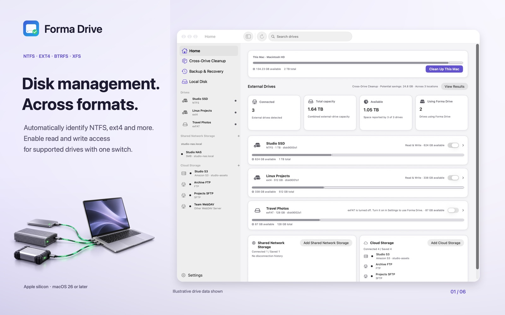
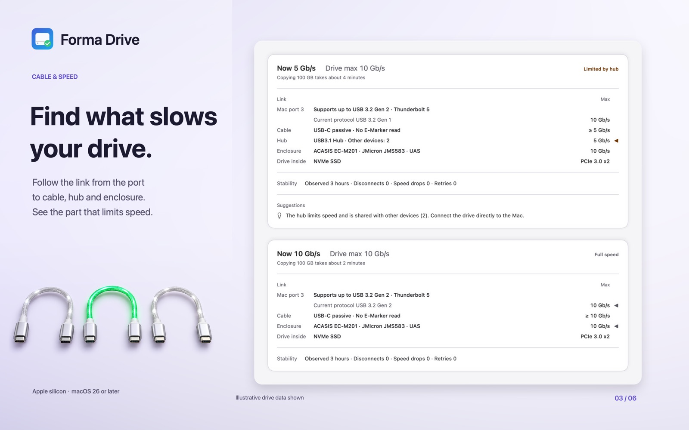
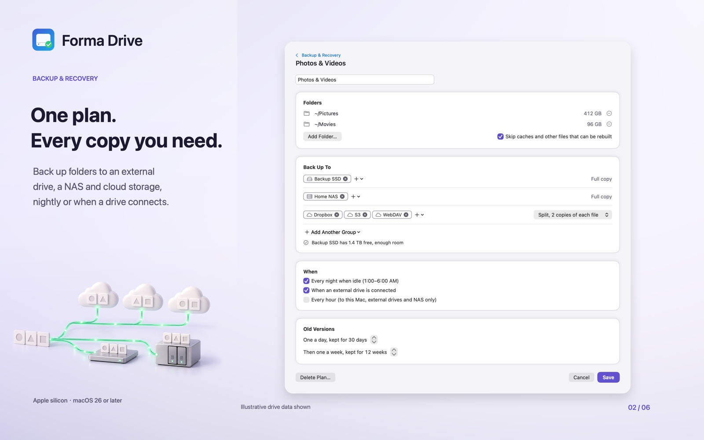

# Forma Drive

Use Windows and Linux drives on your Mac like any other drive, and see where your disk space goes.

## What you get

- Read and write NTFS, ext4, Btrfs and XFS drives in Finder. exFAT and FAT32 too.
- See which part of the connection (Mac port, cable, enclosure, drive) limits the speed of a slow copy.
- Unlock BitLocker and LUKS encrypted drives with their password.
- Back up folders to an external drive, a NAS or cloud storage, with old versions kept and copies checked.
- See what fills your Mac, external drives and cloud storage, and clean caches and build files. Cleaned items go to the Trash.
- Find duplicate files across drives and cloud storage.

## Requirements

Apple silicon Mac, macOS 26 or later. One-time purchase on the Mac App Store, no subscription, no account.

## Links

- Website: https://safafish.com/formadrive/
- Docs: https://safafish.com/formadrive/docs/
- Mac App Store: https://apps.apple.com/app/apple-store/id6809373340?pt=127927245&ct=github&mt=12
- Support: https://safafish.com/formadrive/support.html

This repository hosts the project page only. The app is distributed on the Mac App Store.
